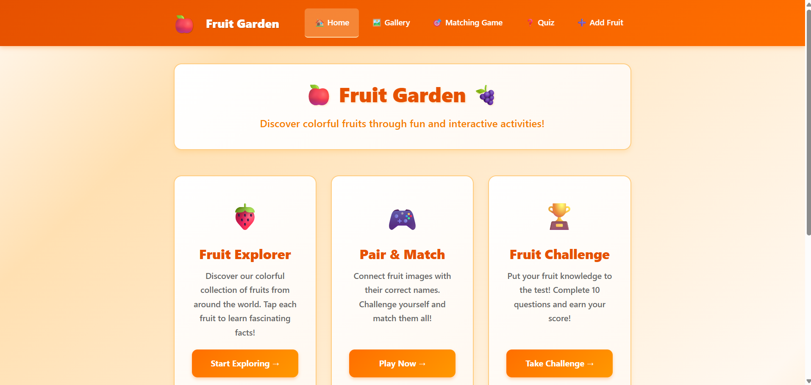
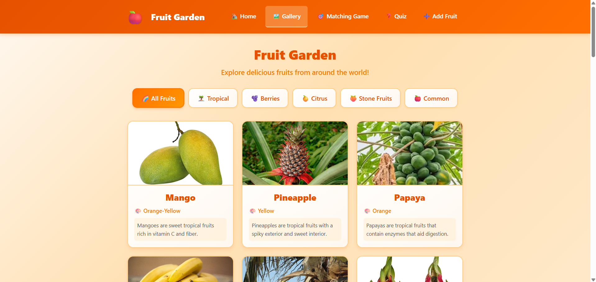
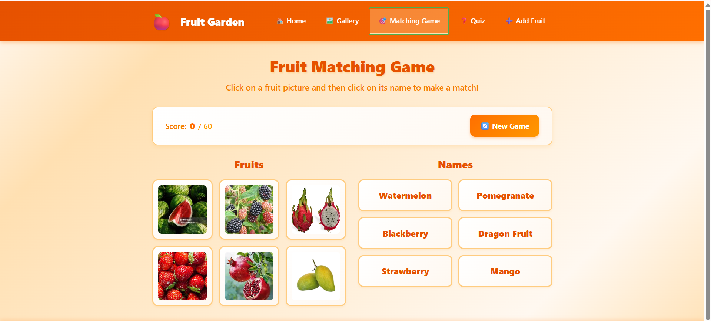
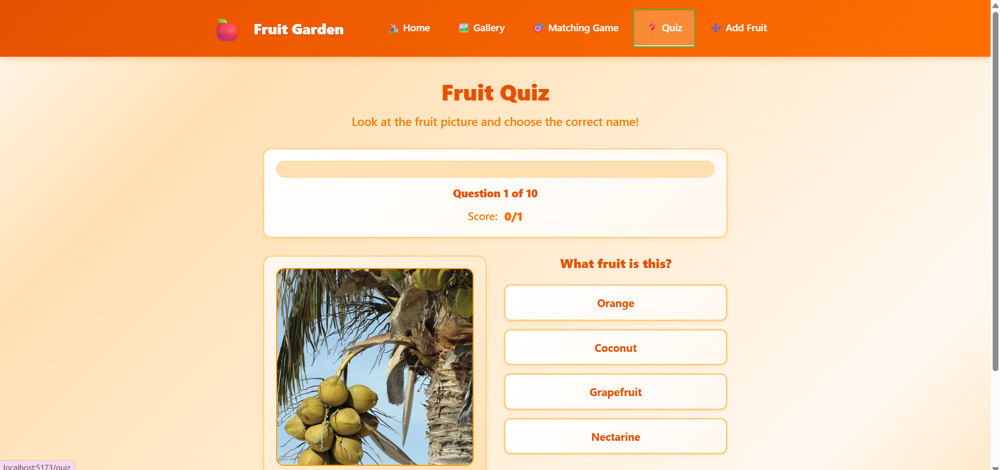
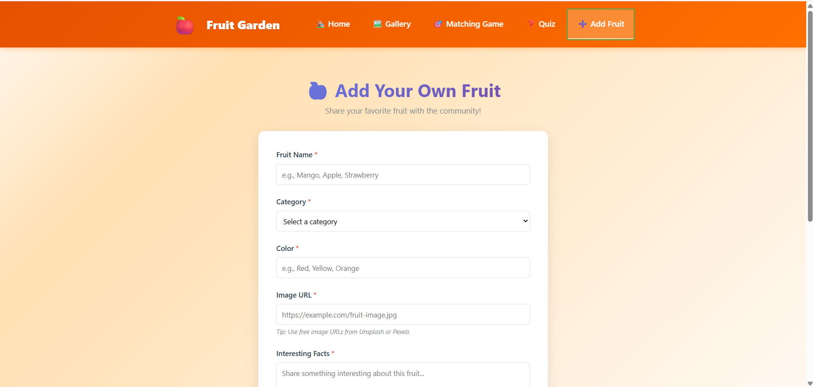

# 🍎 Fruit Learning App

<p align="center">
  
  
  
  
</p>

<p align="center">
  An interactive and educational web application designed to make
  learning about fruits fun through a gallery, quizzes, and matching games.
</p>

<p align="center">
  <a href="https://github.com/Varunnachimuthu-S/Fruit-Learning-App">
    View Repository
  </a>
</p>

---

## 📸 Application Screenshots

### 🏠 Home Page

Explore the application and navigate to different learning activities.



### 🍇 Fruit Gallery

Browse the available fruits and explore the fruit collection.



### 🎮 Fruit Matching Game

Explore the interactive fruit-matching activity.



### 🧠 Fruit Quiz

Test your fruit knowledge with an interactive quiz.



### ➕ Add Fruit

Explore the form for adding new fruits to the application.



---

## ✨ Features

- 🏠 **Home Page:** Entry point for navigating the application.
- 🍓 **Fruit Gallery:** Browse a collection of fruits.
- 🎮 **Matching Game:** Practice through an interactive matching activity.
- 🧠 **Fruit Quiz:** Test fruit knowledge with a quiz.
- ➕ **Add Fruit:** Add fruit entries through a form.
- 🧭 **Page Navigation:** Navigate between pages using React Router.
- ⚛️ **React Components:** Organize the application into reusable UI components.

---

## 🛠️ Tech Stack

| Technology | Purpose |
|---|---|
| React.js | Building the user interface |
| JavaScript (ES6+) | Application logic and interactions |
| Vite | Development server and build tool |
| React Router | Navigation between application pages |
| HTML5 | Application structure |
| CSS3 | Styling and responsive layouts |
| Git & GitHub | Version control and source code hosting |

---

## 🚀 Getting Started

Follow these steps to run the project locally.

### Prerequisites

- Node.js
- npm
- Git (optional, for cloning the repository)

### 1. Clone the repository

```bash
git clone https://github.com/Varunnachimuthu-S/Fruit-Learning-App.git